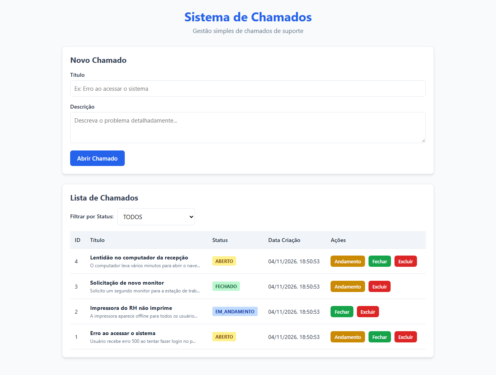
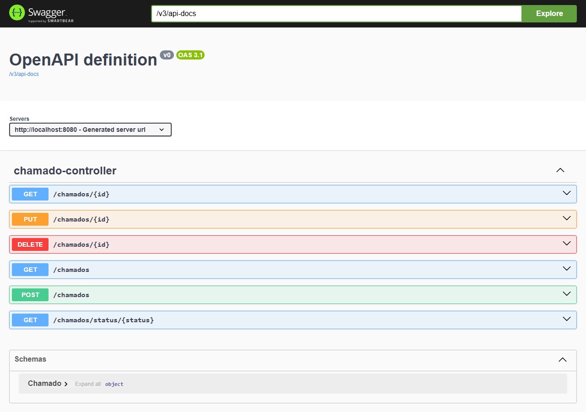

# Sistema de Chamados

API REST simples para gerenciamento de chamados de suporte, feita como projeto de estudo com **Java 21**, **Spring Boot 3.4**, **Spring Data JPA** e **MySQL**.

O projeto tem CRUD de chamados, um ciclo de status simples, validação dos dados e um dashboard estático para testar a API pelo navegador.

> **Status:** projeto de estudo/portfólio. Não é pronto para produção e ainda não tem autenticação.

## Telas

Dashboard:



Documentação da API no Swagger:



## Funcionalidades

- Criar, listar, buscar por ID ou status, atualizar e excluir chamados.
- Todo chamado novo começa com status `ABERTO` e recebe a data de criação.
- Ao fechar um chamado, a data de fechamento é preenchida; ao reabrir, ela é limpa.
- Validação de título e descrição com Bean Validation.
- `GET /chamados/{id}` retorna `404 Not Found` quando o chamado não existe.
- Documentação gerada com Springdoc OpenAPI (Swagger UI).
- Dashboard estático em `src/main/resources/static`.
- Docker Compose com MySQL, healthcheck e volume persistente.
- Testes unitários da camada de serviço com JUnit 5 e Mockito.

## Tecnologias

- Java 21 e Spring Boot 3.4.5
- Spring Data JPA, Hibernate e MySQL 8.0
- Jakarta Bean Validation
- Springdoc OpenAPI 2.8.5
- Maven
- JUnit 5 e Mockito
- Docker e Docker Compose

## Como rodar

### Opção 1: Docker

Pré-requisitos: Docker e Docker Compose.

1. Crie o arquivo de ambiente:

   ```powershell
   Copy-Item .env.example .env
   ```

2. Suba os containers:

   ```bash
   docker compose up --build -d
   ```

3. Acesse:

   - Dashboard: `http://localhost:8080`
   - Swagger: `http://localhost:8080/swagger-ui.html`
   - API: `http://localhost:8080/chamados`

4. Para parar:

   ```bash
   docker compose down
   ```

O `.env.example` tem apenas valores locais. Não commite o `.env`.

### Opção 2: local

Pré-requisitos: Java 21, Maven e MySQL 8.

1. Crie o banco:

   ```sql
   CREATE DATABASE helpdesk_pro;
   ```

2. Configure a conexão no PowerShell:

   ```powershell
   $env:SPRING_DATASOURCE_URL = "jdbc:mysql://localhost:3306/helpdesk_pro?useSSL=false&allowPublicKeyRetrieval=true&serverTimezone=America/Sao_Paulo"
   $env:SPRING_DATASOURCE_USERNAME = "root"
   $env:SPRING_DATASOURCE_PASSWORD = "sua_senha"
   ```

3. Inicie a aplicação:

   ```bash
   mvn spring-boot:run
   ```

## Endpoints

Base: `http://localhost:8080`

| Método | Rota | Descrição |
| :--- | :--- | :--- |
| `GET` | `/chamados` | Lista os chamados, do mais novo para o mais antigo |
| `GET` | `/chamados/{id}` | Busca um chamado pelo ID |
| `GET` | `/chamados/status/{status}` | Filtra por status |
| `POST` | `/chamados` | Cria um chamado |
| `PUT` | `/chamados/{id}` | Atualiza um chamado |
| `DELETE` | `/chamados/{id}` | Exclui um chamado |

Status possíveis: `ABERTO`, `EM_ANDAMENTO` e `FECHADO`.

### Exemplo de criação

```http
POST /chamados
Content-Type: application/json
```

```json
{
  "titulo": "Erro ao acessar o sistema",
  "descricao": "O usuário recebe erro 500 ao tentar fazer login."
}
```

Resposta (`201 Created`):

```json
{
  "id": 1,
  "titulo": "Erro ao acessar o sistema",
  "descricao": "O usuário recebe erro 500 ao tentar fazer login.",
  "status": "ABERTO",
  "dataCriacao": "2026-10-24T15:00:00",
  "dataFechamento": null
}
```

## Estrutura

```text
src/main/java/com/example/helpdesk/
├── controller/   # Endpoints REST
├── exception/    # Exceção de recurso não encontrado
├── model/        # Entidade Chamado e enum StatusChamado
├── repository/   # Interfaces do Spring Data JPA
└── service/      # Regras de negócio
```

A entidade `Chamado` também é usada como corpo das requisições para manter o projeto simples. Em um projeto maior, eu usaria DTOs separados.

## Testes

```bash
mvn test
```

A suíte atual tem 4 testes da camada de serviço: listagem, criação, fechamento e atualização sem alterar o status. A camada HTTP ainda não tem testes.

## O que pratiquei

- Organização em camadas com controller, service e repository.
- Mapeamento JPA, queries derivadas e transações.
- Validação com Bean Validation.
- Testes unitários com JUnit 5 e Mockito.
- Spring Boot e MySQL rodando com Docker Compose.
- Documentação de API com Swagger.

## Próximos passos

- Autenticação e autorização.
- Testes de controller e integração.
- Paginação e ordenação.
- CI para rodar os testes e montar a imagem Docker.

## Licença

MIT. Veja [LICENSE](LICENSE).

Desenvolvido por [Emanuel Vitor](https://github.com/evfernandes-dev).
